# About this guide

The workbench is the desktop application of the *fuzzy-tolerance-clustering*
project. It runs the possibilistic clustering algorithms of D. A. Viattchenin's
D-AFC family — the algorithms described in the book *Fuzzy Tolerance Clustering:
Theory, Algorithms, and Implementations* — on your own data, shows the tolerance
relation, the allotments and the validity indices, and turns a clustering
solution into a fuzzy inference system.

This guide explains the application screen by screen. The mathematics behind
the options is only summarised here; the book is the reference for it. The
same algorithms are available without a graphical interface as the command-line
tool `mfuzzy` and as a .NET library (see @sec-cli).

Source code, data sets and releases: <https://github.com/adamaratski/fuzzy-tolerance-clustering>.

# Installation and first start

**Requirements.** Windows 10 or 11, 64-bit. Nothing else needs to be installed:
the archive contains a single executable with the .NET runtime inside.

**Installation.**

1. Download `FuzzyToleranceClustering-Workbench-<version>-win-x64.zip` from the
   *Releases* page of the repository. The file `*.zip.sha256` next to it holds the
   SHA-256 checksum of the archive.
2. Unpack the archive into any folder. It contains `Math.Fuzzy.Desktop.exe`, the
   folder `datasets` with the benchmark data sets of the book, `LICENSE.txt` and
   a short `README.txt`.
3. Start `Math.Fuzzy.Desktop.exe`.

The executable is not code-signed. On the first start Windows SmartScreen may
report an unknown publisher; choose *More info* and then *Run anyway*.

**First start.** The application opens the Dashboard with two sample data sets
from the `datasets` folder next to the executable: Anderson's Iris data
(150 objects, 4 attributes, 3 classes) and the Yang–Wu data (16 objects,
2 attributes). If the folder is missing, the application starts empty and data
can be opened with *Open data*.

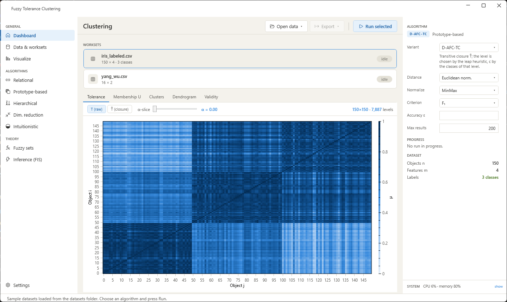{width=100%}

# The screen

The window has four areas (see the figure above).

* **Navigation** (left). *General* holds the Dashboard, the data page and the
  scatter plot. *Algorithms* lists the four categories of algorithms; choosing a
  category returns to the Dashboard and selects the category's first algorithm.
  *Theory* holds two pages for exploring fuzzy sets and fuzzy inference.
* **Header** of the Dashboard. *Open data* loads a CSV file or a tolerance matrix,
  *Export* saves the results of the last run, *Run selected* starts the algorithm
  configured in the right panel. While a run is in progress the button turns
  into *Stop*, next to it the algorithm name and the elapsed time are shown, and
  a progress bar appears under the header.
* **Workspace** (centre). The list of *worksets* — the data sets opened in this
  session, each with its status (*idle*, *running…*, *done*, *error*) — and the
  result tabs *Tolerance*, *Membership U*, *Clusters*, *Dendrogram* and
  *Validity*. Below the tabs a green bar summarises the best allotment of the
  last run and three tiles show its number of clusters, purity and adjusted
  Rand index (the last two only when the data set has class labels).
* **Right panel.** The parameters of the selected algorithm (@sec-algorithms),
  the progress of the current run, a summary of the active data set and the
  *System* monitor with the load of the processor, the memory and the graphics
  adapters. The monitor can be paused with the small link in its corner.

The status bar at the bottom reports what happened last: a loaded file, the
result of a run with its validity indices, or the reason why a run did not start.

# Loading data

## CSV files

*Open data → CSV data…* (Ctrl+O) opens a comma-separated file. The rules are:

* A header row is optional. Column names from the header are used as attribute
  names on the scatter plot and in the inference page.
* Every numeric column is an attribute. Values use a decimal point.
* One column may hold class labels. A text column is treated as the label column
  automatically; a numeric column is treated as labels when its header is
  `class`, `label`, `labels`, `type`, `species`, `variety`, `target` or
  `category`. Labels are never used by the algorithms — they serve only to compute
  purity, the Rand indices and the mutual information after a run.

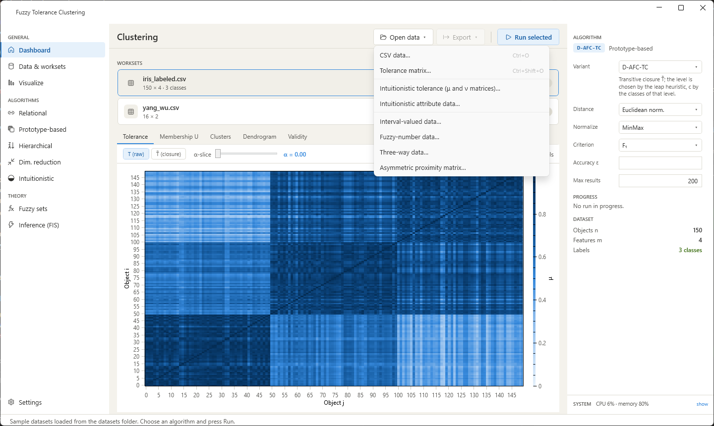{width=100%}

Every opened file becomes a workset. Click a workset to make it active: the
right panel, the result tabs and the scatter plot switch to it, and a run always
applies to the active workset. The data sets shipped with the application have the
format described above; the file `datasets/README.md` lists their sources.

## Tolerance matrices

*Open data → Tolerance matrix…* (Ctrl+Shift+O) loads an $n \times n$ matrix $T$
with entries in $[0,1]$. The diagonal is set to 1 and the matrix is used as the
fuzzy tolerance relation directly, without attributes. Such a workset shows the
matrix on the *Tolerance* tab and can be examined there, but the algorithms of
this version run on attribute data only (@sec-troubleshooting).

## The data page

*Data & worksets* shows the same list of worksets, the size of the active data
set and a preview of its first rows. The buttons *Build T* and *Closure T̃*
compute the tolerance matrix and its max-min transitive closure for the active
data set with the distance, normalisation and accuracy of the right panel, and
display them on the *Tolerance* tab without running a clustering.

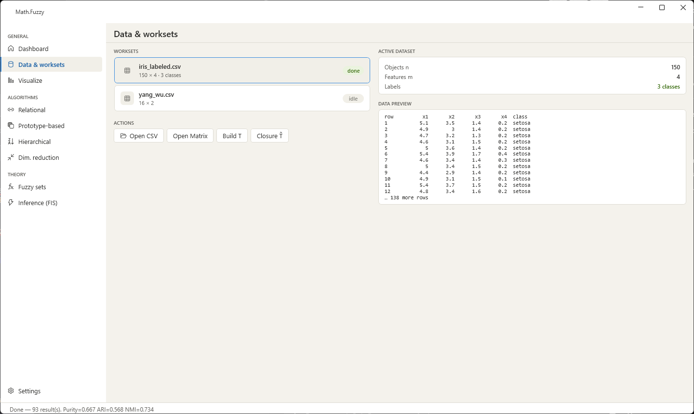{width=100%}

# Choosing an algorithm {#sec-algorithms}

The navigation picks a category, the *Variant* box in the right panel picks the
algorithm within it, and a short line under the box says what the algorithm does.
The blue chip at the top of the panel always shows the selected algorithm.

| Category | Algorithm | Needs $c$? | What it does |
|:--|:--|:--|:--|
| Relational | D-AFC | yes | The basic algorithm: the best allotment among $c$ clusters over all $\alpha$-levels of $T$. |
| Relational | D-PAFC | no | The principal allotment: the least number of clusters at the first admissible level. |
| Prototype-based | D-AFC-TC | no | Replaces $T$ by its transitive closure $\widetilde{T}$; the level is chosen by the leap heuristic, the number of clusters follows from the level. |
| Prototype-based | D-AFC-TC($\alpha$) | no | As D-AFC-TC, but the leap is searched only at levels not below a threshold $\alpha^*$ given by the user. |
| Prototype-based | D-PAFC-TC | no | The principal allotment on $\widetilde{T}$: its first splitting level. |
| Prototype-based | D-AFC-TAGA, D-PAFC-TAGA | no | The same with a transitive approximation built by an aggregation operator instead of the closure. Experimental in this version. |
| Hierarchical | H-AFC-TC | no | The allotments of every level of $\widetilde{T}$, shown as a dendrogram. |
| Dim. reduction | D-PAFC-DR, D-PAFC-TC-DR, D-PAFC-TAGA-DR | no | Attribute selection: the same algorithms applied to a tolerance relation between the attributes. |

: The algorithms of the workbench. {#tbl-algorithms}

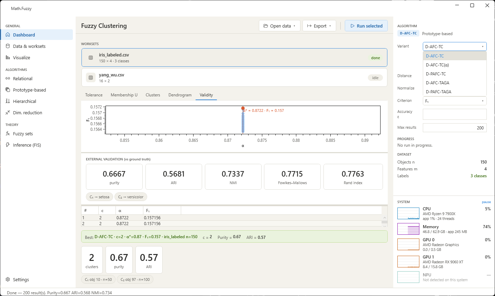{width=100%}

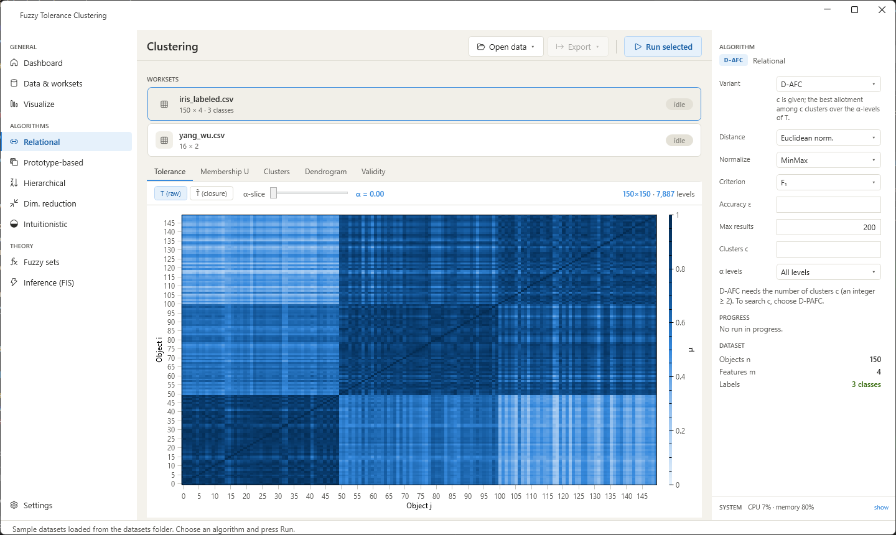{width=100%}

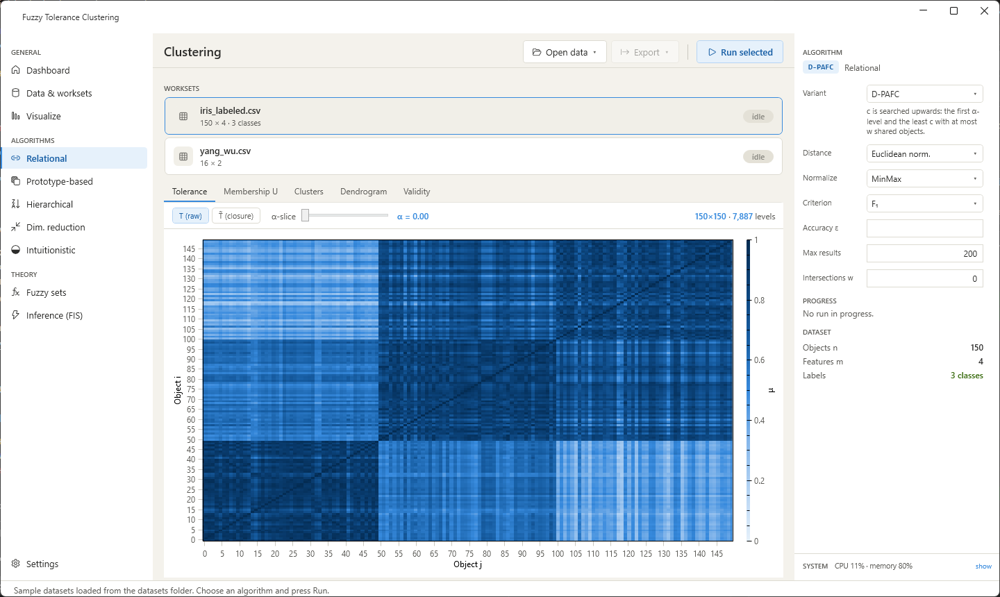{width=100%}

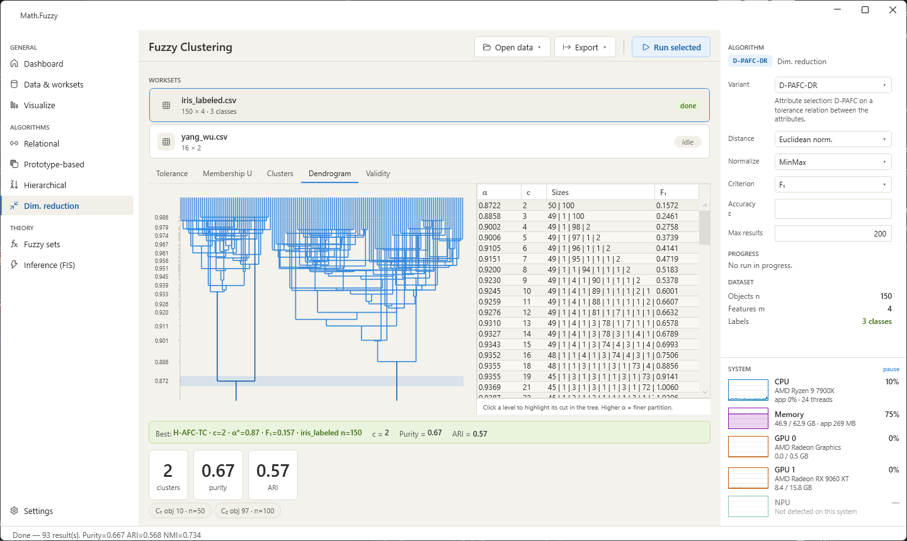{width=100%}

## Parameters

The upper part of the panel is the same for every algorithm:

* **Distance.** How the dissimilarity of two objects is measured on the
  normalised attributes: the normalised Hamming distance, the normalised
  Euclidean distance, its square, the Manhattan, Chebyshev, Minkowski (with its
  order $p$) and cosine distances. The tolerance is $T_{ij} = 1 - d(x_i, x_j)$.
* **Normalize.** *MinMax* maps every attribute onto $[0,1]$ (unitarisation);
  *Max* divides every attribute by its largest value (the normalisation of the
  original experiments); *None* leaves the data as they are.
* **Criterion.** $F_1$ or $F_2$, the two criteria by which allotments of the same
  level are compared; $F_1$ penalises the number of clusters.
* **Accuracy ε.** When set, every entry of $T$ is rounded to the nearest multiple
  of ε before the levels are built. This merges levels that differ by less than ε
  and enlarges the kernels of the clusters. Leave the field empty for full
  precision. Typical values are 0.00001 to 0.01.
* **Max results.** How many allotments are kept in the result list.

The lower part depends on the algorithm:

* **Clusters c** (D-AFC): the number of clusters, an integer of at least 2.
* **α levels** (D-AFC): *All levels* searches every distinct level of $T$;
  *Manual* searches a single level: the highest level of $T$ that does not exceed
  the **α\* threshold** entered below.
* **α\* threshold** (D-AFC-TC($\alpha$)): the lowest admissible level.
* **Intersections w** (D-PAFC): the number of objects allowed to lie in more
  than one cluster; 0 asks for fully separated clusters.
* **TAGA operator** (TAGA variants): the aggregation operator of the transitive
  approximation.

{width=100%}

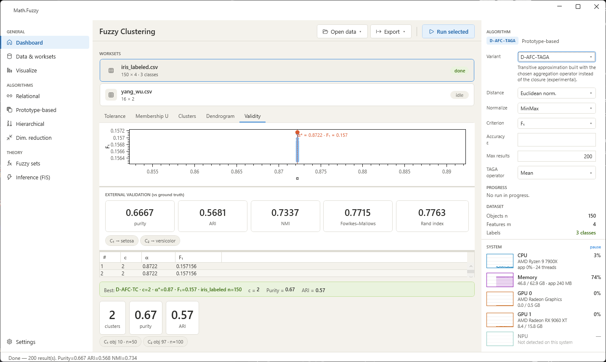{width=100%}

A parameter that is missing or out of range is reported in red under the fields,
and *Run selected* does nothing until it is corrected.

::: {.callout-tip}
## Reproducing the experiments of the book

The original experiments on the Iris data use the squared Euclidean distance,
normalisation *Max* and the accuracy ε = 0.00001. With D-AFC and c = 3 this
setting gives the allotment of the monograph with six misclassified objects.
:::

# Running an algorithm

Select the workset, configure the panel and press *Run selected*. The workset
shows *running…*, the header shows the elapsed time and *Stop*, and the progress
bar reports the scan of the levels. Most runs on the sample data take well under a
second; the relational algorithms on a few hundred objects can take minutes,
because they enumerate combinations of centres on every level. *Stop* interrupts a
run at the next level; the results of the previous run stay on the tabs.

When the run finishes, the status bar prints the number of allotments found and —
for labelled data — purity, the adjusted Rand index and the normalised mutual
information of the best one. If no allotment satisfies the parameters, the status
bar says so; typical remedies are a different distance, *All levels* instead of a
manual level, or a larger $w$.

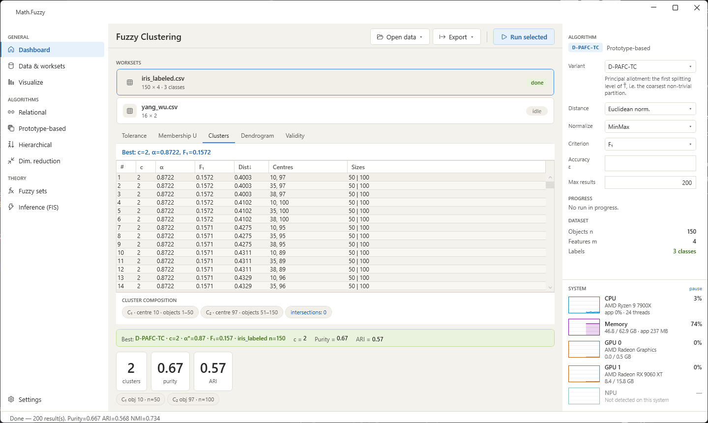{width=100%}

# Reading the results

## Clusters

The table lists the allotments found, best first: the rank, the number of
clusters, the level α, the value of the criterion, the prototype distance used to
break ties (closure-based algorithms only), the centres (typical points, 1-based
object numbers) and the sizes of the clusters. Selecting a row shows its
composition below the table: every cluster with its centre and the ranges of its
objects, and the number of objects lying in more than one cluster.

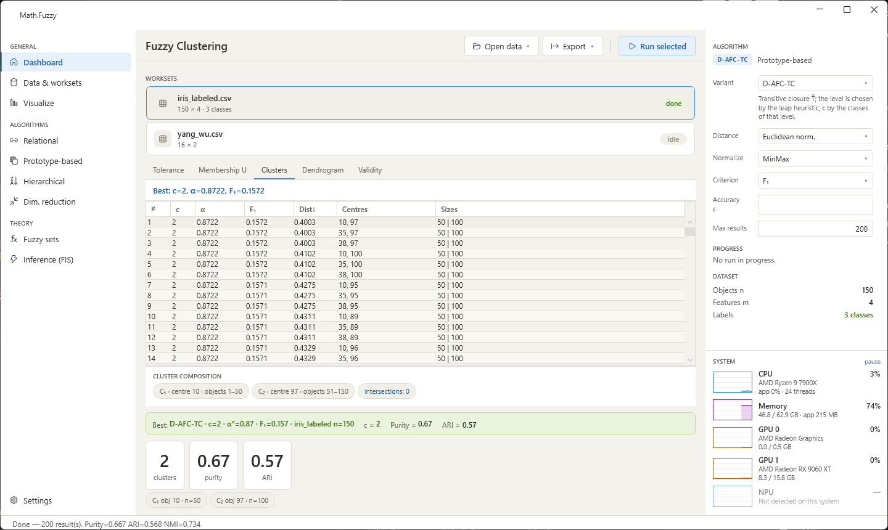{width=100%}

## Membership U

The membership matrix of the selected allotment as a heat map: one row per object,
one column per cluster, the colour giving the membership degree $\mu$. The
*threshold* slider hides memberships below a value, *sort by cluster* orders the
objects by their cluster. Clicking a row shows the memberships of that object on
the right.

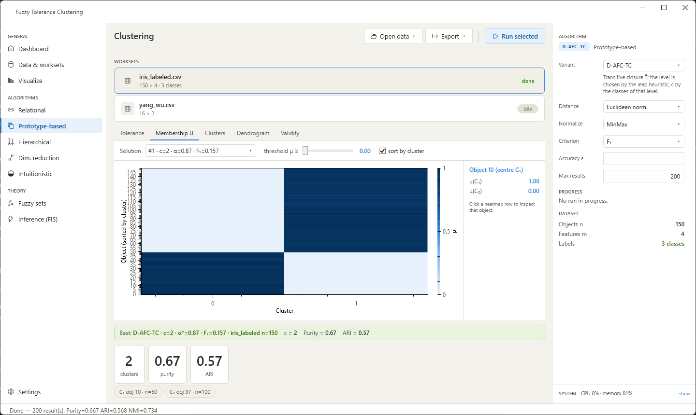{width=100%}

## Tolerance

The tolerance matrix $T$ built with the parameters of the last run, and — with
the button *T̃ (closure)* — its max-min transitive closure. The number of distinct
levels is shown at the right; the *α-slice* slider blanks every entry below the
chosen level, which shows the crisp relation $T_\alpha$ at that level. Objects are
in file order.

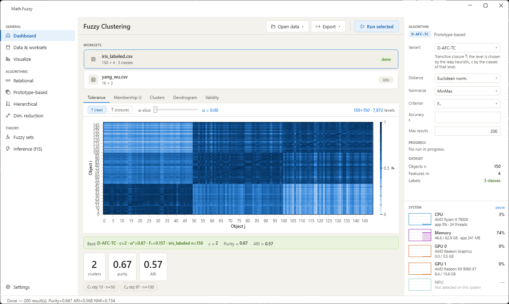{width=100%}

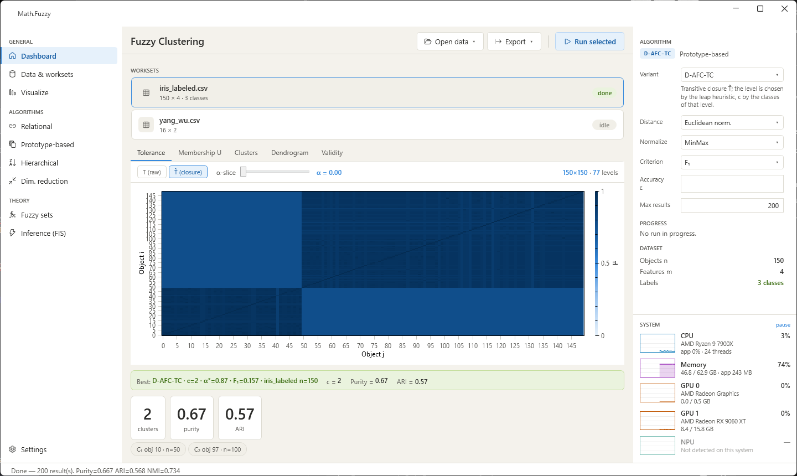{width=100%}

## Dendrogram

After a run of H-AFC-TC the tab shows the hierarchy of allotments: the levels of
$\widetilde{T}$ on the vertical axis, the finest partition at the top, merges at
decreasing α going down. The table on the right lists every level with its
number of clusters, the cluster sizes and the criterion; clicking a level
highlights its cut in the tree. For other algorithms the tab is empty.

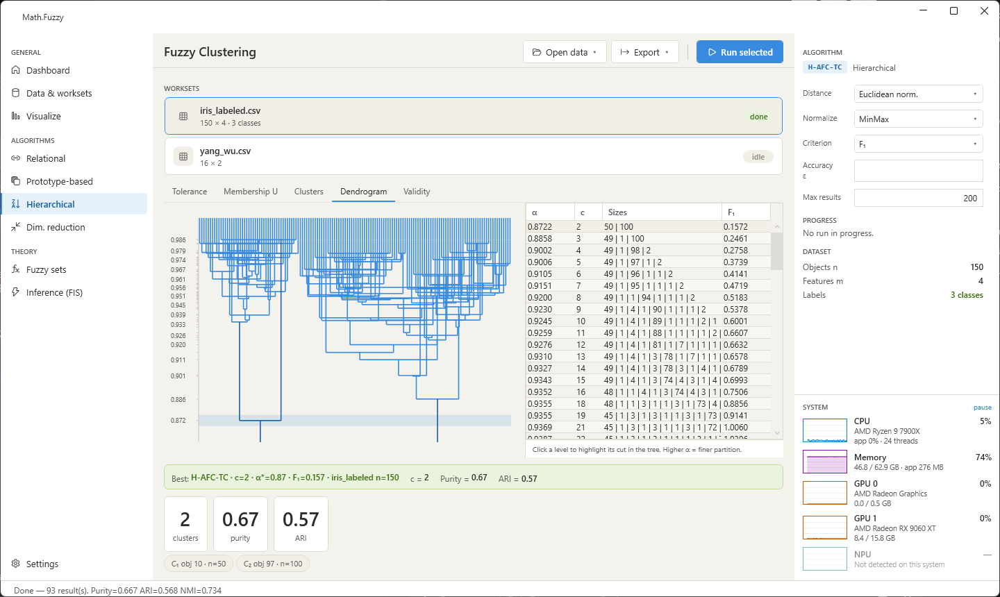{width=100%}

## Validity

The upper plot shows the criterion of every allotment against its level, with the
best one marked. For labelled data the block *External validation* gives purity,
the adjusted Rand index, the normalised mutual information, the Fowlkes–Mallows
index and the Rand index of the best allotment, and the majority class of every
cluster.

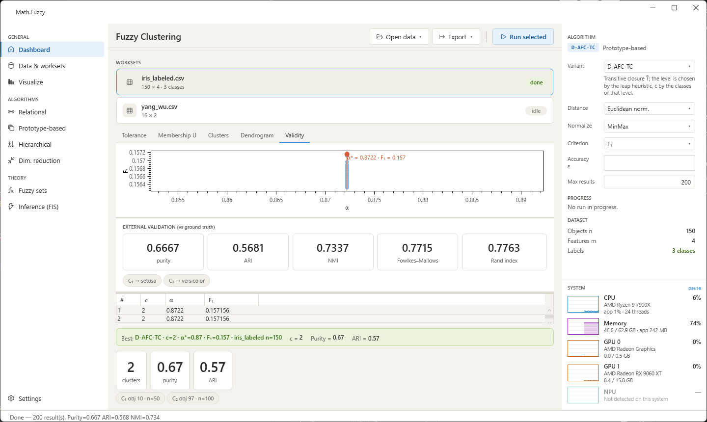{width=100%}

# Visualize

The scatter plot shows the active workset in two chosen attributes. *Color by*
switches between the clusters of the best allotment of the last run — with the
typical points as black diamonds and objects of several clusters ringed — and the
true classes of the file. The caption under the toolbar says which run and which
data set the colours refer to.

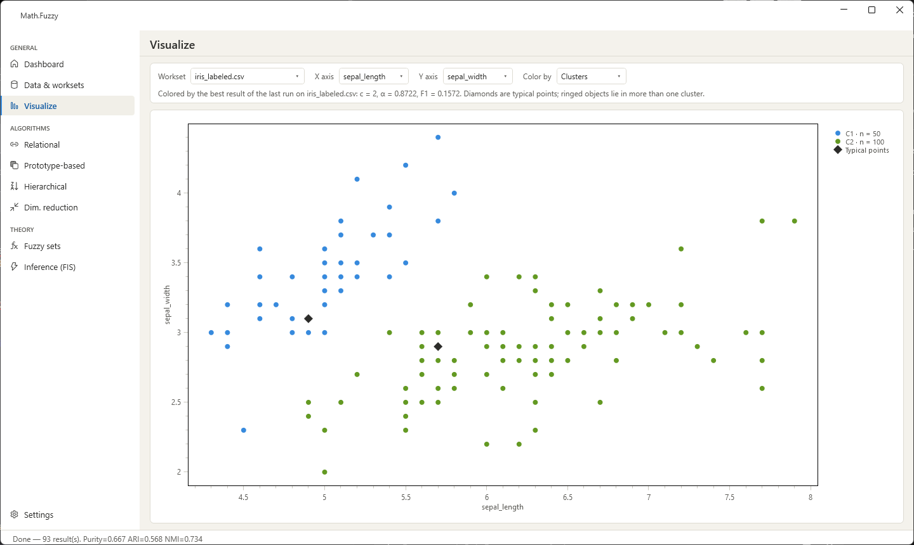{width=100%}

# Export

*Export → Results as JSON…* writes every allotment of the last run with its
level, criterion, centres and clusters; object numbers are 1-based, as everywhere
in the workbench. *Export → Results as CSV…* writes one row per allotment for
spreadsheets. The command-line tool writes the same allotments in its own JSON
layout, with 0-based object numbers and with the validity indices.

# Theory pages

## Fuzzy sets

A small laboratory for membership functions. *Shapes* draws one fuzzy set of a
chosen shape (triangular, trapezoidal or Gaussian); the parameters can be
typed or the square handles dragged on the plot, and the panel reports the
height, support, core, α-cut, crossover points, cardinality and centroid.
*Operations* combines two sets with a t-norm, an s-norm or a complement, with
every operator of the chosen family, and defuzzifies the result by five methods.
*From cluster* shows how a fuzzy cluster of the last run becomes a term of the
antecedent of a rule.

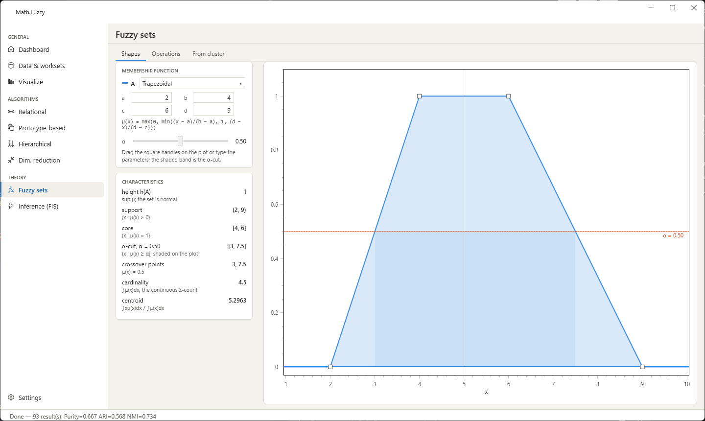{width=100%}

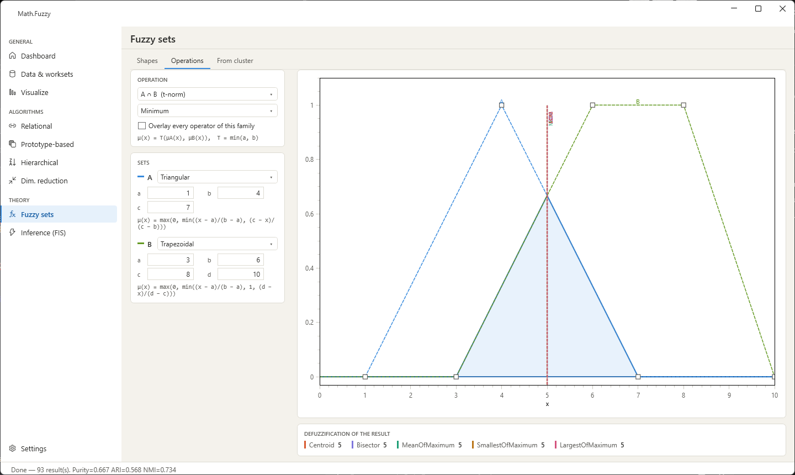{width=100%}

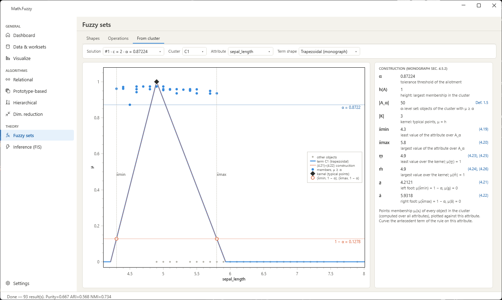{width=100%}

## Inference (FIS)

The inference page generates a fuzzy rule base from a clustering solution and
lets you experiment with it.

* **Solution** picks an allotment of the last run; **Rule base** the kind of
  system: a Mamdani system with one output per cluster (the construction of the
  book), a classifier whose consequents are the class labels, a Mamdani
  regression system, or a Takagi–Sugeno system of order 0 or 1 (the last three
  predict the column chosen in **Target**); **MF shape** the shape of the terms.
  *Regenerate* builds the rules.
* **Rules.** One rule per cluster. Each rule can be switched off, its terms and
  weight changed; the bar at the right shows its firing strength for the current
  input.
* **Membership functions.** The terms of one variable; parameters can be typed or
  dragged.
* **Input vector.** Sliders for every attribute; *Load* copies an object of the
  data set into them.
* **Output.** The decision, the output values and the aggregated output set with
  its defuzzified value.
* **Evaluation on the workset.** The accuracy of the rule base on all objects and
  its confusion matrix.

The rule base can be exported as JSON or as a MATLAB Fuzzy Logic Toolbox file
(`.fis`); a JSON file can be imported back, and evaluated without the workbench
by `mfuzzy infer`.

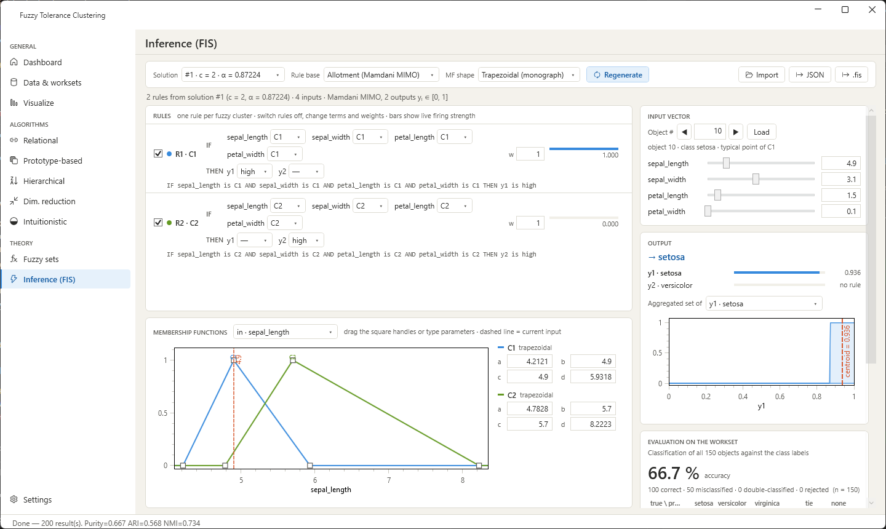{width=100%}

# Settings

The page sets the defaults for the number of results kept and the minimal size of
a cluster (applied by the relational algorithms D-AFC and D-PAFC), and shows the
versions of the components.

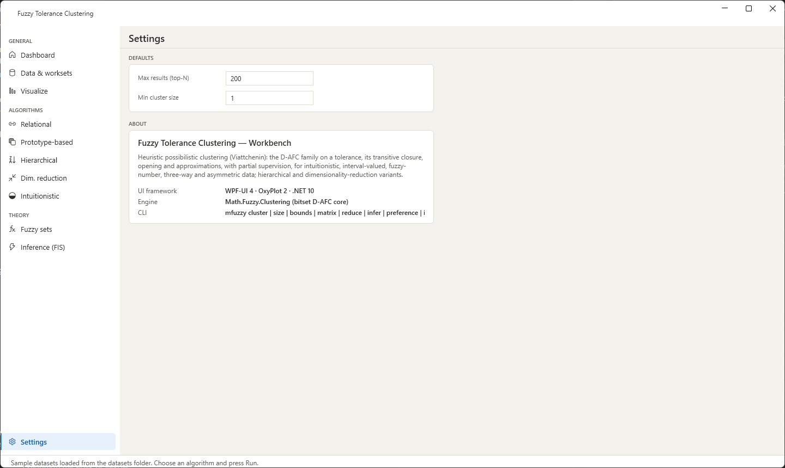{width=100%}

# Troubleshooting {#sec-troubleshooting}

* *Windows refuses to start the application.* SmartScreen: choose *More info →
  Run anyway*. The checksum of the archive can be verified against the
  `.sha256` file published with the release.
* *"D-AFC needs the number of clusters c."* Enter an integer of at least 2 in
  *Clusters c*, or choose D-PAFC to have the number searched.
* *"No valid clustering found."* No allotment satisfies the parameters. With a
  manual level try *All levels*; with D-PAFC increase *w*; try another distance.
* *A run takes minutes.* The relational algorithms enumerate centre combinations
  on every level; a few hundred objects with $c = 3$ can take several minutes,
  and partially separated clusters ($w > 0$) rescan all levels. The closure-based
  algorithms are fast. *Stop* interrupts a run.
* *A workset loaded as a matrix cannot be run.* The algorithms of this version
  take attribute data; a matrix workset can be inspected on the *Tolerance* tab.
* *The TAGA variants give unexpected results.* The transitive approximation is
  experimental in this version and its results are not reported in the book.
* *The results of a previous run are still shown after an error.* They belong to
  the previous run; the status bar reports the error of the new one.

# The command-line tool {#sec-cli}

The clustering runs of the workbench can be reproduced from a terminal with the
tool `mfuzzy` of the same repository, for example

```
mfuzzy cluster --algorithm dafc --input datasets/iris_labeled.csv --clusters 3 ^
    --distance squared-euclidean --normalize max --accuracy 0.00001
```

The options carry the names of the panel fields (`--distance`, `--normalize`,
`--criterion`, `--accuracy`, `--clusters`, `--alpha`, `--intersections`, `--taga`),
and `--format json` writes the same JSON as the *Export* command. The README of
the repository documents the tool, the .NET library and the MATLAB toolbox.
