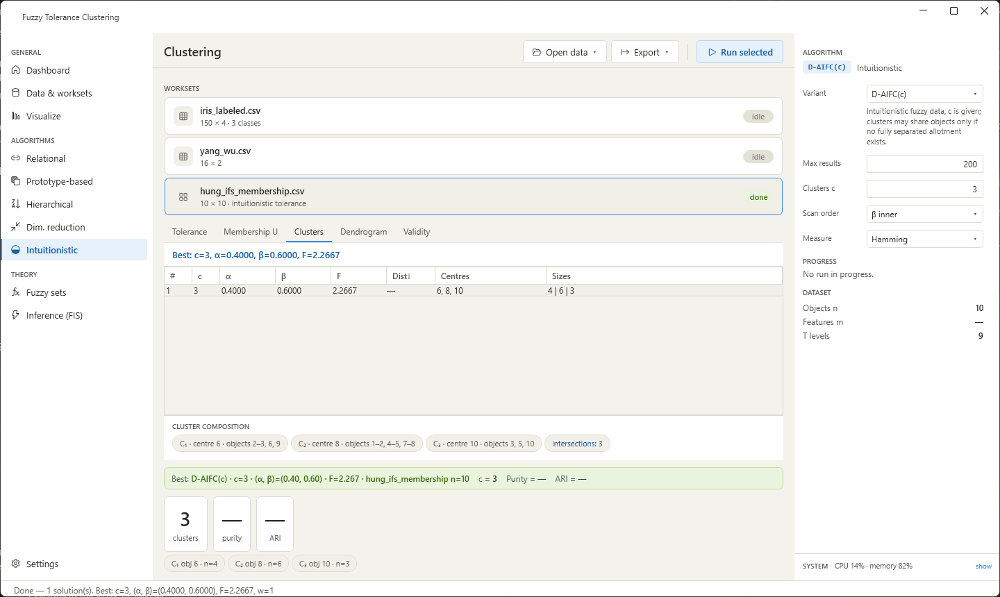
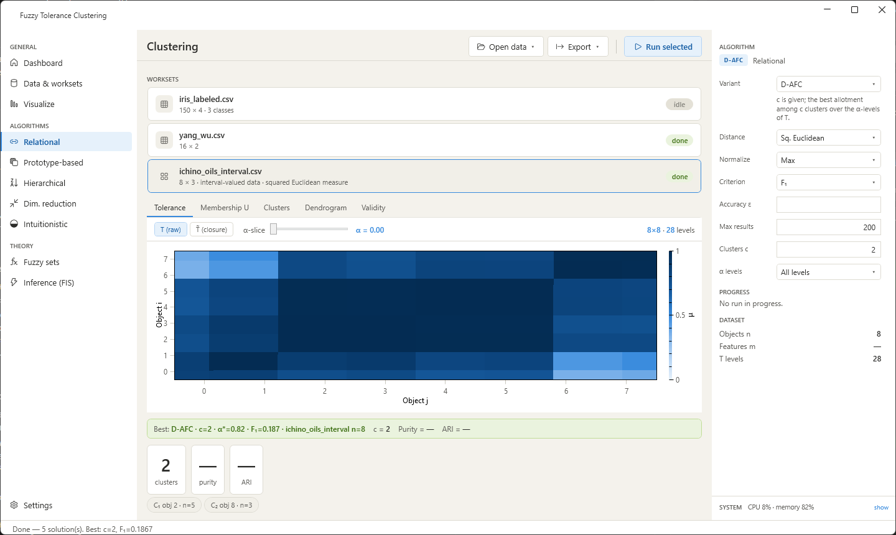
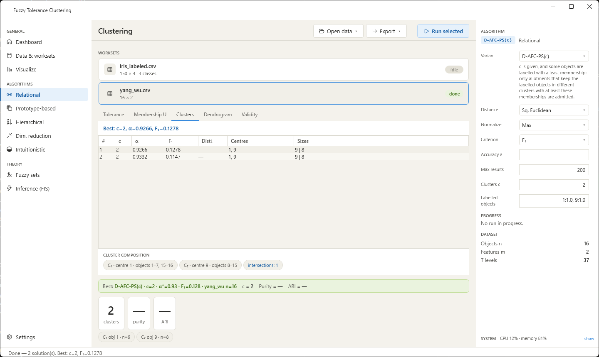

# About this guide

The workbench is the desktop application of the *fuzzy-tolerance-clustering*
project. It runs the possibilistic clustering algorithms of D. A. Viattchenin's
D-AFC family — the algorithms described in the book *Fuzzy Tolerance Clustering:
Theory, Algorithms, and Implementations* — on your own data, shows the tolerance
relation, the allotments and the validity indices, and turns a clustering
solution into a fuzzy inference system.

This guide explains the application screen by screen. The mathematics behind
the options is only summarised here; the book is the reference for it. The
same algorithms are available without a graphical interface as the command-line
tool `mfuzzy` and as a .NET library (see @sec-cli).

Source code, data sets and releases: <https://github.com/adamaratski/fuzzy-tolerance-clustering>.

# Installation and first start

**Requirements.** Windows 10 or 11, 64-bit. Nothing else needs to be installed:
the archive contains a single executable with the .NET runtime inside.

**Installation.**

1. Download `FuzzyToleranceClustering-Workbench-<version>-win-x64.zip` from the
   *Releases* page of the repository. The file `*.zip.sha256` next to it holds the
   SHA-256 checksum of the archive.
2. Unpack the archive into any folder. It contains `Math.Fuzzy.Desktop.exe`, the
   folder `datasets` with the benchmark data sets of the book, `LICENSE.txt` and
   a short `README.txt`.
3. Start `Math.Fuzzy.Desktop.exe`.

The executable is not code-signed. On the first start Windows SmartScreen may
report an unknown publisher; choose *More info* and then *Run anyway*.

**First start.** The application opens the Dashboard with two sample data sets
from the `datasets` folder next to the executable: Anderson's Iris data
(150 objects, 4 attributes, 3 classes) and the Yang–Wu data (16 objects,
2 attributes). If the folder is missing, the application starts empty and data
can be opened with *Open data*.

{width=100%}

# The screen

The window has four areas (see the figure above).

* **Navigation** (left). *General* holds the Dashboard, the data page and the
  scatter plot. *Algorithms* lists the five categories of algorithms; choosing a
  category returns to the Dashboard and selects the category's first algorithm.
  *Theory* holds two pages for exploring fuzzy sets and fuzzy inference.
* **Header** of the Dashboard. *Open data* loads a CSV file, a tolerance matrix or one of the other kinds of data (@sec-loading),
  *Export* saves the results of the last run, *Run selected* starts the algorithm
  configured in the right panel. While a run is in progress the button turns
  into *Stop*, next to it the algorithm name and the elapsed time are shown, and
  a progress bar appears under the header.
* **Workspace** (centre). The list of *worksets* — the data sets opened in this
  session, each with its status (*idle*, *running…*, *done*, *error*) — and the
  result tabs *Tolerance*, *Membership U*, *Clusters*, *Dendrogram* and
  *Validity*. Below the tabs a green bar summarises the best allotment of the
  last run and three tiles show its number of clusters, purity and adjusted
  Rand index (the last two only when the data set has class labels).
* **Right panel.** The parameters of the selected algorithm (@sec-algorithms),
  the progress of the current run, a summary of the active data set and the
  *System* line with the load of the processor and the memory; *show* opens the
  monitor with the graphics adapters, which can be paused with the link next to it.

The status bar at the bottom reports what happened last: a loaded file, the
result of a run with its validity indices, or the reason why a run did not start.

# Loading data {#sec-loading}

## CSV files

*Open data → CSV data…* (Ctrl+O) opens a delimited text file (comma, semicolon or tab separated; with a semicolon or tab a decimal comma is accepted). The rules are:

* A header row is optional. Column names from the header are used as attribute
  names on the scatter plot and in the inference page.
* Every numeric column is an attribute. Values use a decimal point.
* One column may hold class labels. A text column is treated as the label column
  automatically; a numeric column is treated as labels when its header is
  `class`, `label`, `labels`, `type`, `species`, `variety`, `target`, `category` or
  `group`. Labels are never used by the algorithms — they serve only to compute
  purity, the Rand indices and the mutual information after a run. A missing value is reported as an error with its position; a text
  column whose values are all different (object names) is ignored.

{width=100%}

Every opened file becomes a workset. Click a workset to make it active: the
right panel, the result tabs and the scatter plot switch to it, and a run always
applies to the active workset. The data sets shipped with the application have the
format described above; the file `datasets/README.md` lists their sources.

## Tolerance matrices

*Open data → Tolerance matrix…* (Ctrl+Shift+O) loads an $n \times n$ matrix $T$
with entries in $[0,1]$. The diagonal is set to 1 and the matrix is used as the
fuzzy tolerance relation directly, without attributes. The matrix must be
symmetric; a header row and a first column of object names are allowed. Every
algorithm except the dimensionality reduction runs on such a workset. Since there
are no attributes, the prototype-based algorithms then resolve ties between
typical points by the object number, and the pages that need attributes
(*Visualize*, the inference system) stay empty.

## Intuitionistic fuzzy data {#sec-ifs-data}

The algorithms of the category *Intuitionistic* (@sec-algorithms) work on
intuitionistic fuzzy data, in which every degree of membership $\mu$ comes with a
degree of non-membership $\nu$. There are two ways to open such data:

* *Open data → Intuitionistic tolerance (μ and ν matrices)…* loads an intuitionistic
  fuzzy tolerance. Two file dialogs follow one another: first the $n \times n$
  matrix of memberships, then the matrix of non-memberships. Both are
  read as the tolerance matrix above (a header row and a column of names are
  allowed). The data set `datasets/hung_ifs_membership.csv` with
  `datasets/hung_ifs_nonmembership.csv` is an example.
* *Open data → Intuitionistic attribute data…* loads one CSV file whose numeric
  columns come in pairs (membership, non-membership) per attribute, for
  example `f1_mu,f1_nu,f2_mu,f2_nu,…`; `datasets/cars10_ifs.csv` is an example. The
  tolerance is built from the pairs with the similarity measure chosen in the
  panel (Hamming or Euclidean).

The *Tolerance* tab shows the matrix of memberships of such a workset. If an
intuitionistic algorithm is started on ordinary data, or an ordinary algorithm on
intuitionistic data, the status bar says what to open or which category to choose.

{width=100%}

## Interval-valued, fuzzy-number, three-way and asymmetric data {#sec-other-data}

Four further items of the *Open data* menu, below the intuitionistic ones, read
one CSV file each. The fuzzy tolerance is built while the file is loaded, and the
result is a workset on which the relational, prototype-based and hierarchical
algorithms run exactly as on a tolerance matrix. The *Tolerance* tab shows the
tolerance; *Distance*, *Normalize* and *Accuracy ε* have no effect on such a
workset, because the tolerance is already built. The workset line shows the kind
of data.

* *Interval-valued data…* The columns come in pairs `name_lo,name_hi` (the lower
  and the upper bound of an attribute); an optional text column holds the object
  names. The tolerance is built with the squared Euclidean measure between
  intervals and unitarisation over both bounds. `datasets/ichino_oils_interval.csv`
  (eight oils, four attributes) is an example; D-AFC with $c = 2$ gives
  $\alpha^* = 0.8185$.
* *Fuzzy-number data…* Every attribute takes the columns `name_m,name_a,name_b`
  (modal value, left and right spread), or `name_ml,name_mr,name_a,name_b` (fuzzy
  intervals), or `name_m,name_sigma` (Gaussian numbers). All attributes of one
  file must be of the same kind. `datasets/yang_ko_30.csv` is an example.
* *Three-way data…* One row per object and situation: the first column holds the
  object, the second the situation, the remaining columns are the attributes.
  Every object must have a row for every situation. The tolerance uses
  unitarisation and the squared generalised Euclidean distance.
  `datasets/sato_sato_threeway.csv` (38 boys, four measurements, three ages) is an
  example; D-AFC with $c = 3$ gives $\alpha^* = 0.9312$ and clusters of 3, 7 and
  28 objects.
* *Asymmetric proximity matrix…* A square matrix that need not be symmetric (a
  header row and a column of names are allowed). A zero diagonal is read as
  dissimilarities, a unit diagonal as similarities. `datasets/children_dislike.csv`
  (16 children) is an example; D-PAFC gives five clusters at $\alpha = 0.6667$.

The workbench uses the defaults named above. Other settings of these
constructions (other interval measures, the Ju–Yuan exponent, likeness instead of
quasi-equivalence and so on) are available in the command-line tool
(@sec-cli). Since these worksets have no attributes in the sense of the CSV
files, the remarks on tolerance matrices apply to them as well.

{width=100%}

## The data page

*Data & worksets* shows the same list of worksets, the size of the active data
set and a preview of its first rows. The buttons *Build T* and *Closure T̃*
compute the tolerance matrix and its max-min transitive closure for the active
data set with the distance, normalisation and accuracy of the right panel, and
display them on the *Tolerance* tab without running a clustering.

{width=100%}

# Choosing an algorithm {#sec-algorithms}

The navigation picks a category, the *Variant* box in the right panel picks the
algorithm within it, and a short line under the box says what the algorithm does.
The blue chip at the top of the panel always shows the selected algorithm.

| Category | Algorithm | Needs $c$? | What it does |
|:--|:--|:--|:--|
| Relational | D-AFC | yes | The basic algorithm: the best allotment among $c$ clusters over all $\alpha$-levels of $T$. |
| Relational | D-AFC(u) | no | The largest cluster size $u$ is given instead of $c$; the number of clusters and the threshold follow. The clusters may share objects only if no fully separated allotment exists. |
| Relational | D-PAFC | no | The principal allotment: the least number of clusters at the first admissible level. |
| Relational | D-AFC-PS($c$) | yes | Partial supervision: $c$ is given and some objects are labelled with a least membership; only allotments that keep the labelled objects in different clusters with at least these memberships are admitted. |
| Prototype-based | D-AFC-TC | no | Replaces $T$ by its transitive closure $\widetilde{T}$; the level is chosen by the leap heuristic, the number of clusters follows from the level. |
| Prototype-based | D-AFC-TC($\alpha$) | no | As D-AFC-TC, but the leap is searched only at levels not below a threshold $\alpha^*$ given by the user. |
| Prototype-based | D-PAFC-TC | no | The principal allotment on $\widetilde{T}$: its first splitting level. |
| Prototype-based | D-AFC-TO | no | As D-AFC-TC, but on a transitive opening of $T$ (a fuzzy equivalence below $T$) instead of the closure. |
| Prototype-based | D-AFC-TO($\alpha$) | no | As D-AFC-TC($\alpha$), on the transitive opening; the threshold $\alpha^*$ is given by the user. |
| Prototype-based | D-PAFC-TO | no | As D-PAFC-TC, on the transitive opening. |
| Prototype-based | D-AFC-TAGA,D-AFC-TAGA($\alpha$), D-PAFC-TAGA | no | The same three algorithms with a transitive approximation built by an aggregation operator instead of the closure. |
| Hierarchical | H-AFC-TC, H-AFC-TAGA | no | The allotments of every level of $\widetilde{T}$ or of the transitive approximation, shown as a dendrogram. |
| Dim. reduction | D-PAFC-DR, D-PAFC-TC-DR, D-PAFC-TAGA-DR | no | Attribute selection: the same algorithms applied to a tolerance relation between the attributes. |
| Intuitionistic | D-PAIFC | no | Intuitionistic fuzzy data: the first pair of thresholds $(\alpha, \beta)$ at which the intuitionistic fuzzy clusters are fully separated, i.e. the least number of clusters. |
| Intuitionistic | D-AIFC(c) | yes | The number of clusters $c$ is given; the clusters may share objects only if no fully separated allotment exists (the bound $w$ on the pairwise intersections is raised 0, 1, …). |
| Intuitionistic | D-PAIFC-TC | no | D-PAIFC on the transitive closure of the intuitionistic fuzzy tolerance (max-min on the memberships, min-max on the non-memberships). |
| Intuitionistic | D-AIFC-PS($c$) | yes | The intuitionistic counterpart of D-AFC-PS($c$): labelled objects carry a least membership $y$ and a largest non-membership $f$. |

: The algorithms of the workbench. {#tbl-algorithms}

{width=100%}

{width=100%}

{width=100%}

{width=100%}

## Parameters

The upper part of the panel is the same for every algorithm:

* **Distance.** How the dissimilarity of two objects is measured on the
  normalised attributes: the normalised Hamming distance, the normalised
  Euclidean distance, its square, the Manhattan, Chebyshev, Minkowski (with its
  order $p$) and cosine distances. The tolerance is $T_{ij} = 1 - d(x_i, x_j)$.
* **Normalize.** *MinMax* maps every attribute onto $[0,1]$ (unitarisation);
  *Max* divides every attribute by its largest value (the normalisation of the
  original experiments); *None* leaves the data as they are.
* **Criterion.** $F_1$ or $F_2$, the two criteria by which allotments of the same
  level are compared; $F_1$ penalises the number of clusters.
* **Accuracy ε.** When set, every entry of $T$ is rounded to the nearest multiple
  of ε before the levels are built. This merges levels that differ by less than ε
  and enlarges the kernels of the clusters. Leave the field empty for full
  precision. Typical values are 0.00001 to 0.01.
* **Max results.** How many allotments are kept in the result list.

The lower part depends on the algorithm:

* **Clusters c** (D-AFC): the number of clusters, an integer of at least 2.
* **α levels** (D-AFC): *All levels* searches every distinct level of $T$;
  *Manual* searches a single level: the highest level of $T$ that does not exceed
  the **α\* threshold** entered below.
* **Max size u** (D-AFC(u)): the largest number of objects a cluster may have,
  an integer below the number of objects.
* **Clusters c** (D-AFC-PS($c$)): as for D-AFC.
* **Labelled objects** (D-AFC-PS($c$), D-AIFC-PS($c$)): a text field with the
  objects whose class is known. Objects are numbered from 1 and separated by
  commas, each as `object:y`, where $y$ is the least membership the object must
  have in its cluster, for example `1:1.0, 9:0.9`. For intuitionistic data the
  form is `object:y:f`, with the largest non-membership $f$ added, for example
  `1:1.0:0.0, 5:0.9:0.1`. Appending `@k` puts several labelled objects into one
  class $k$: `3:0.8@1, 4:0.7@1, 9:0.9@2`. A field that cannot be read is reported
  in red under the parameters. If no allotment is consistent with the labels, the
  *Clusters* tab says "No valid clustering found".
* **Opening** (D-AFC-TO, D-AFC-TO($\alpha$), D-PAFC-TO): the transitive opening of
  $T$. *Complete linkage* (the default) reproduces the published example;
  *Single-linkage order* is the cited algorithm with the bound that keeps its
  result transitive.
* **α\* threshold** (D-AFC-TC($\alpha$), D-AFC-TO($\alpha$), D-AFC-TAGA($\alpha$)): the lowest admissible level.
* **Intersections w** (D-PAFC): the number of objects allowed to lie in more
  than one cluster; 0 asks for fully separated clusters.
* **TAGA operator** (TAGA variants): the aggregation operator of the transitive
  approximation — maximum (the transitive closure), minimum, mean, median, upper
  and lower median. *Automatic* computes all six approximations and takes the one
  nearest to $T$.

{width=100%}

{width=100%}

{width=100%}

The category *Intuitionistic* has its own parameters; *Distance*, *Normalize*,
*Criterion* and *Accuracy ε* are not shown for it (the criterion is $F_{IFS}$):

* **Clusters c** (D-AIFC(c), D-AIFC-PS($c$)): the number of clusters.
* **Labelled objects** (D-AIFC-PS($c$)): see above.
* **Scan order** (all the algorithms of the category): the order in which the pairs $(\alpha, \beta)$ are
  scanned, *β inner* (the default), *β outer* or *order-free*. *β outer* reproduces the
  published D-PAIFC result on the relation of Hung, Lee and Fuh. The pairs are only
  partially ordered, so the first admissible pair depends on the order, and neither
  *β inner* nor *β outer* is guaranteed to give the least number of clusters.
  *order-free* is the definition proposed in the accompanying book, not a published one.
  It examines all admissible pairs, finds the least number of clusters on the frontier of
  the loosest pairs, and among all allotments with that number returns the one with the
  largest quality $Q_{IFS}$, the sum over the clusters of the mean membership minus the
  mean non-membership. It is available for D-PAIFC and D-PAIFC-TC; with D-AIFC(c)
  and D-AIFC-PS($c$) the workbench shows a parameter message instead of running.
* **Measure** (*Hamming* or *Euclidean*): the similarity measure that builds the
  tolerance from intuitionistic attribute data; it is not used when a tolerance
  was opened as two matrices.

The result line shows the pair $(\alpha, \beta)$ and, for D-AIFC(c), the
bound $w$. For *order-free* the pair is the one of the allotment itself: its least
membership degree and its largest non-membership degree; the status bar shows the same
pair.

A parameter that is missing or out of range is named under the fields. *Run
selected* does nothing until it is corrected, and the message turns red when the
button is pressed in that state.

::: {.callout-tip}
## Reproducing the experiments of the book

The original experiments on the Iris data use the squared Euclidean distance,
normalisation *Max* and the accuracy ε = 0.00001. With D-AFC and c = 3 this
setting gives the allotment of the monograph with six misclassified objects.
:::

# Running an algorithm

Select the workset, configure the panel and press *Run selected*. The workset
shows *running…*, the header shows the elapsed time and *Stop*, and the progress
bar reports the scan of the levels. Most runs on the sample data take well under a
second; the relational algorithms on a few hundred objects can take minutes,
because they enumerate combinations of centres on every level. *Stop* interrupts a
run at the next level; the results of the previous run stay on the tabs.

When the run finishes, the status bar prints the number of allotments found and —
for labelled data — purity, the adjusted Rand index and the normalised mutual
information of the best one. If no allotment satisfies the parameters, the status
bar says so; typical remedies are a different distance, *All levels* instead of a
manual level, or a larger $w$.

{width=100%}

# Reading the results

## Clusters

The table lists the allotments found, best first: the rank, the number of
clusters, the level α, the value of the criterion, the prototype distance used to
break ties (closure-based algorithms only), the centres (typical points, 1-based
object numbers) and the sizes of the clusters. Selecting a row shows its
composition below the table: every cluster with its centre and the ranges of its
objects, and the number of objects lying in more than one cluster.

{width=100%}

## Membership U

The membership matrix of the selected allotment as a heat map: one row per object,
one column per cluster, the colour giving the membership degree $\mu$. The
*threshold* slider hides memberships below a value, *sort by cluster* orders the
objects by their cluster. Clicking a row shows the memberships of that object on
the right.

{width=100%}

## Tolerance

The tolerance matrix $T$ — built with the current distance and normalisation when
the data are opened, and with the parameters of the run after a run — and, with
the button *T̃ (closure)*, its max-min transitive closure. The number of levels,
counted as the algorithms count them, is shown at the right; the *α-slice* slider blanks every entry below the
chosen level, which shows the crisp relation $T_\alpha$ at that level. Objects are
in file order.

{width=100%}

{width=100%}

## Dendrogram

After a run of H-AFC-TC or H-AFC-TAGA the tab shows the hierarchy of allotments: the levels of
the relation on the vertical axis, the finest partition at the top, merges at
decreasing α going down. The table on the right lists every level with its
number of clusters, the cluster sizes and the criterion; clicking a level
highlights its cut in the tree. For other algorithms the tab is empty.

{width=100%}

## Validity

The upper plot shows the criterion of every allotment against its level, with the
best one marked. For labelled data the block *External validation* gives purity,
the adjusted Rand index, the normalised mutual information, the Fowlkes–Mallows
index and the Rand index of the best allotment, and the majority class of every
cluster.

{width=100%}

# Visualize

The scatter plot shows the active workset in two chosen attributes. *Color by*
switches between the clusters of the best allotment of the last run — with the
typical points as black diamonds and objects of several clusters ringed — and the
true classes of the file. The caption under the toolbar says which run and which
data set the colours refer to.

{width=100%}

# Export

*Export → Results as JSON…* writes every allotment of the last run with its
level, criterion, centres and clusters; object numbers are 1-based, as everywhere
in the workbench. *Export → Results as CSV…* writes one row per allotment for
spreadsheets. The command-line tool writes the same allotments in its own JSON
layout, with 0-based object numbers and with the validity indices.

# Theory pages

## Fuzzy sets

A small laboratory for membership functions. *Shapes* draws one fuzzy set of a
chosen shape (triangular, trapezoidal or Gaussian); the parameters can be
typed or the square handles dragged on the plot, and the panel reports the
height, support, core, α-cut, crossover points, cardinality and centroid.
*Operations* combines two sets with a t-norm, an s-norm or a complement, with
every operator of the chosen family, and defuzzifies the result by five methods.
*From cluster* shows how a fuzzy cluster of the last run becomes a term of the
antecedent of a rule.

{width=100%}

{width=100%}

{width=100%}

## Inference (FIS)

The inference page generates a fuzzy rule base from a clustering solution and
lets you experiment with it.

* **Solution** picks an allotment of the last run; **Rule base** the kind of
  system: a Mamdani system with one output per cluster (the construction of the
  book), a classifier whose consequents are the class labels, a Mamdani
  regression system, or a Takagi–Sugeno system of order 0 or 1 (the last three
  predict the column chosen in **Target**); **MF shape** the shape of the terms.
  *Regenerate* builds the rules.
* **Rules.** One rule per cluster. Each rule can be switched off, its terms and
  weight changed; the bar at the right shows its firing strength for the current
  input.
* **Membership functions.** The terms of one variable; parameters can be typed or
  dragged.
* **Input vector.** Sliders for every attribute; *Load* copies an object of the
  data set into them.
* **Output.** The decision, the output values and the aggregated output set with
  its defuzzified value.
* **Evaluation on the workset.** The accuracy of the rule base on all objects and
  its confusion matrix.

The rule base can be exported as JSON or as a MATLAB Fuzzy Logic Toolbox file
(`.fis`); a JSON file can be imported back, and evaluated without the workbench
by `mfuzzy infer`.

{width=100%}

# Settings

The page sets the defaults for the number of results kept and the minimal size of
a cluster (applied by every algorithm), and shows the
versions of the components.

{width=100%}

# Troubleshooting {#sec-troubleshooting}

* *Windows refuses to start the application.* SmartScreen: choose *More info →
  Run anyway*. The checksum of the archive can be verified against the
  `.sha256` file published with the release.
* *"D-AFC needs the number of clusters c."* Enter an integer of at least 2 in
  *Clusters c*, or choose D-PAFC to have the number searched.
* *"No valid clustering found."* No allotment satisfies the parameters. With a
  manual level try *All levels*; with D-PAFC increase *w*; try another distance.
* *A run takes minutes.* The relational algorithms enumerate centre combinations
  on every level; a few hundred objects with $c = 3$ can take several minutes,
  and partially separated clusters ($w > 0$) rescan all levels. The closure-based
  algorithms are fast. *Stop* interrupts a run.
* *"The search stopped at its node budget."* A relational run visited more
  combinations than its budget allows. The allotments shown are the best found so
  far and better ones may exist: restrict the search (a manual level, an accuracy
  threshold) or use the command-line tool with a larger `--max-nodes`.
* *A dimensionality-reduction run on a matrix workset is refused.* Attribute
  selection needs attributes; open the data file instead of the matrix.
* *The results of a previous run are still shown after an error.* They belong to
  the previous run; the status bar reports the error of the new one.

# The command-line tool {#sec-cli}

The clustering runs of the workbench can be reproduced from a terminal with the
tool `mfuzzy` of the same repository, for example

```
mfuzzy cluster --algorithm dafc --input datasets/iris_labeled.csv --clusters 3 ^
    --distance squared-euclidean --normalize max --accuracy 0.00001
```

The options carry the names of the panel fields (`--distance`, `--normalize`,
`--criterion`, `--accuracy`, `--clusters`, `--alpha`, `--max-size`, `--intersections`, `--taga`;
`--matrix` for a tolerance matrix),
and `--format json` writes the same JSON as the *Export* command. The README of
the repository documents the tool, the .NET library and the MATLAB toolbox.
The intuitionistic algorithms `dpaifc`, `daifc` and `dpaifc-tc` take either two
matrices (memberships with `--input`, non-memberships with `--nonmembership`) or one
file of intuitionistic attribute data in pairs of columns (`--ifs-measure hamming` or
`euclidean`); `--scan-order beta-inner`, `beta-outer` or `order-free` sets the order of the
scan (`order-free` is not accepted by `daifc`).
For example

```
mfuzzy cluster --algorithm daifc --clusters 3 --input datasets/hung_ifs_membership.csv ^
    --nonmembership datasets/hung_ifs_nonmembership.csv
mfuzzy cluster --algorithm dpaifc-tc --input datasets/cars10_ifs.csv
```

find three clusters at $(\alpha, \beta) = (0.4, 0.6)$ with $w = 1$ and four clusters at
$(0.4833, 0.1667)$. The table has an extra column *Beta*, and the options `--distance`,
`--normalize`, `--criterion` and `--accuracy` are not used.

The tool also has the commands `size` (choice of the largest cluster size $u$), `bounds` (bounds of the number of clusters), `matrix build`, `matrix closure`, `reduce` and `infer`; the README documents them.

The workbench does not cover everything the library does. The stability analysis
of interval-valued data, the selection of project-network paths, the reduction of
large data and the analysis of fuzzy preference relations are available in the
command-line tool only, as the sub-commands `interval-stability`,
`interval-structure`, `project-paths`, `reduce` and `preference`.
